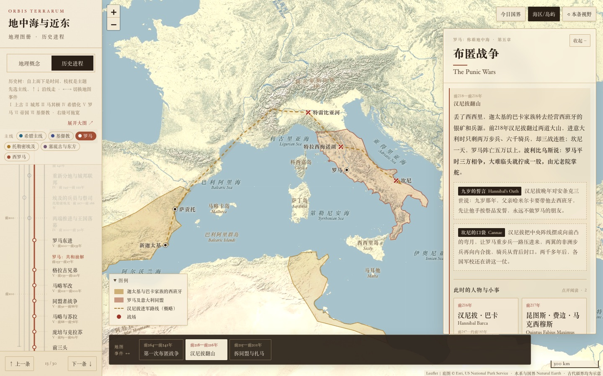
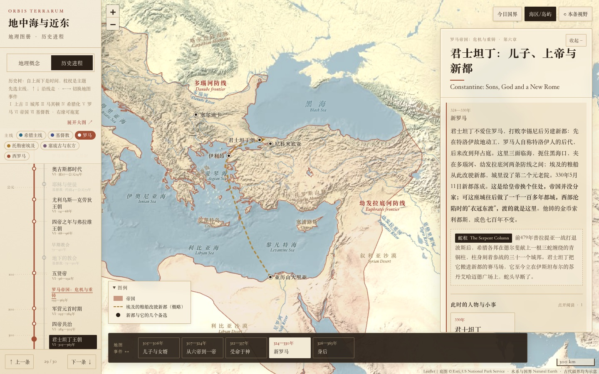

<h1 align="center">History of Europe in Frames</h1>

<p align="center">
  Personal study notes on European history—told scene by scene on interactive maps, from prehistory to the post-WWII era, in a single offline HTML file.
</p>

<p align="center">
  <a href="./index.html"><strong>index.html</strong></a>
  ·
  <a href="https://vercel.com/new/clone?repository-url=https%3A%2F%2Fgithub.com%2Fstabruriss%2Fhistory-of-europe-in-frames"><strong>Deploy with Vercel</strong></a>
  ·
  <a href="./LICENSE">MIT License</a>
</p>

<p align="center">
  <strong>English</strong> · <a href="./README.zh-CN.md">简体中文</a>
</p>

**History of Europe in Frames** is a set of personal study notes on European history, built as an interactive historical atlas. Written in Chinese with English names alongside every person and place, it aims to trace the story of Europe from the first human migrations out of Africa all the way to the world after the Second World War, offering a clear, map-driven reference for Chinese-speaking learners of European history.

Each section unfolds as a sequence of map scenes. As you step from frame to frame, the map redraws to show the shifting territories, routes, and cities of that moment, accompanied by a concise passage explaining what happened and why. Rather than treating history as a simple list of dates or an inevitable march toward modern Europe, the notes read events through the lenses of power, fiscal cost, and political legitimacy—and place contemporary China alongside the West wherever the comparison illuminates both.

The first part, ***地中海与近东* (The Mediterranean and the Near East)**—spanning prehistory through the fall of the Western Roman Empire and the Council of Chalcedon—is complete. Subsequent chapters on medieval, early modern, and modern Europe up to the post-war era will continue to grow along the history tree.

## Interface





## Quick Start

Open `index.html` directly in any desktop or mobile browser. The map engine (Leaflet), base geography, historical territories, narrative text, and biographical cards are all bundled into that single file, so it works out of the box without a local server or an internet connection. When you are online, shaded-relief terrain tiles load automatically and external reading links become active.

What is currently in the atlas:

- **地理概念 (Geography)**: 33 entries covering key seas, mountain ranges, rivers, trade routes, and historical regions.
- **动力专题 (Dynamics & Mechanisms)**: 8 cross-era, cross-civilizational essays (32 map scenes) on the underlying mechanics of history—covering the cost of rule (*The Grail and the Sword*), social ladders, military participation and political voice, why China had no plebeian–patrician tug-of-war, Rome's three-way political triangle, Rome's tiered membership machine, aristocratic "black sheep" and bribery, and why an ungarrisoned capital bred Forum politics.
- **历史进程 (History)**: 10 chapters, 96 sections, and 346 map scenes so far, running from early prehistory through the Roman Empire to the end of the West, East Rome to the end of the Justinian dynasty and Byzantium under Heraclius, the Franks and Lombards to Charlemagne, and the Church to the end of Iconoclasm (843), with Egypt and Persia as lines of their own (from the first states to the Arab conquests) and a parallel timeline of contemporary China (to the Tang).
- **The History Tree**: Time runs vertically along nine tracks—Greek, Rome, East Rome, Byzantium, Medieval Western Europe, Christianity, Egypt, Persia, and a parallel **China** reference line (from Neolithic settlements and the Bronze Age through the Qin, Han, Six Dynasties, Sui and Tang). Egypt and Persia leave the trunk at the early states; the Ptolemies, the Seleucids, Rome and Byzantium appear on them as passing rulers. Every line that stops says why: the Greek line runs into Rome, Rome ends with the West in 476 and splits into East Rome and Medieval Western Europe, East Rome ends with the Justinian dynasty and carries on as Byzantium. A great event that hits several lines at once—the last Roman–Persian war, the Arab conquests—is one shared station on each of them, lit together, with a single set of scenes. Select any line, then use `↑` `↓` to travel along it and `←` `→` to step through the scenes within a section.
- **People and Iconic Moments**: 166 historical figures across 226 dated biographical cards, 192 tags highlighting iconic moments such as Marathon and Thermopylae, 10 short boxed explainers (such as how the Goths fought, Justinian beside Emperor Wu of Han, or how any line will do to split people into two camps), and 735 reading links pointing chiefly to primary sources online.

*Note: Ancient boundaries are drawn as schematic teaching regions clipped to the coastline to aid spatial understanding, rather than as strictly reconstructed frontiers.*

## Build & Deploy

```sh
npm run build        # cd src && python3 assemble.py ../index.html
```

The repository includes a zero-config `vercel.json` so you can import it directly into Vercel—or click [**Deploy with Vercel**](https://vercel.com/new/clone?repository-url=https%3A%2F%2Fgithub.com%2Fstabruriss%2Fhistory-of-europe-in-frames) at the top of this page—for one-click static hosting.

`src/assemble.py` relies only on the Python standard library. It populates the placeholders in `src/template.html` with Leaflet, the base map (`data.json`), the historical territories (`history_geo.json`), the table of contents, the narrative text, and the biographical cards, aborting if any placeholder remains unfilled. Always edit the source files under `src/`, never `index.html` directly.

| Path | Contents |
| --- | --- |
| `src/template.html`, `src/layout.css`, `src/atlas_ui.js` | Page shell, typography and layout styles, and UI logic |
| `src/history_entries.js` | Sections, map scenes, camera views, the history tree, and its thematic lines |
| `src/history_content.json` | Narrative passages, iconic-moment tags, and reading links for each section |
| `src/historical_figures.js` | Historical figures, dated biographical cards, and associated places |
| `src/levante_entries.js`, `src/labels_dates.js`, `src/marine_labels.js` | Geography entries and map labels |
| `src/data.json`, `src/history_geo.json` | Pre-simplified base map and historical territory geometries |
| `src/build*.py` | Python scripts that generate the two geometry files (see below) |
| `tests/verify-*.js` | Automated browser checks, organized by feature area |

## Tests

```sh
npm install
npm test             # runs all tests/verify-*.js suites against index.html
```

The test suite drives a local Chrome instance via `puppeteer-core` to verify:
- Entry counts and per-scene character limits;
- Key phrases and content integrity across scenes;
- History tree navigation and keyboard shortcuts;
- Responsive layout at both desktop and 390 px mobile widths, ensuring no horizontal overflow;
- Zero page errors and full offline functionality.

By default, the scripts look for Chrome at `/Applications/Google Chrome.app`; set `CHROME_PATH` if yours is installed elsewhere. Test screenshots are written to `tests/shots*/`, which Git ignores.

## Regenerating the Geography

You only need these scripts when adding or redrawing map regions; the atlas itself never uses Python at runtime.

The scripts require `shapely` and `pyshp`, along with [Natural Earth](https://www.naturalearthdata.com/) datasets for `build.py` (land, lakes, rivers, and modern borders), `build_history.py` (land), and `build_west_geo.py` (river centerlines). Run them in order from `src/`:

1. `build.py` generates the base map, `data.json`.
2. `build_history.py <natural-earth-dir>` rebuilds `history_geo.json` from scratch.
3. Each subsequent script appends its period's regions to `history_geo.json`: `build_rome_geo.py`, `build_punic_geo.py`, `build_late_rep_geo.py`, `build_west_geo.py <natural-earth-dir>`, `build_empire_geo.py`, and `build_const_geo.py`.

## License

Released under the [MIT License](./LICENSE). Leaflet is bundled under its own BSD-2-Clause license, and the base map is derived from public-domain Natural Earth data. See [THIRD_PARTY_NOTICES.md](./THIRD_PARTY_NOTICES.md) for full details.
